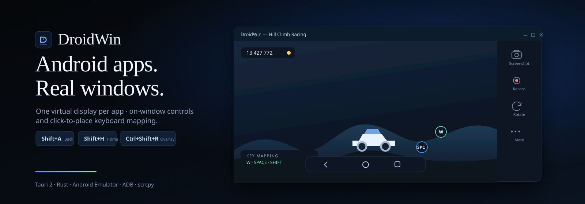
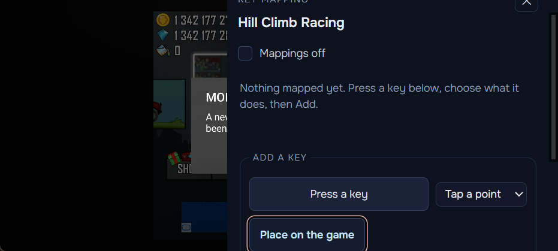
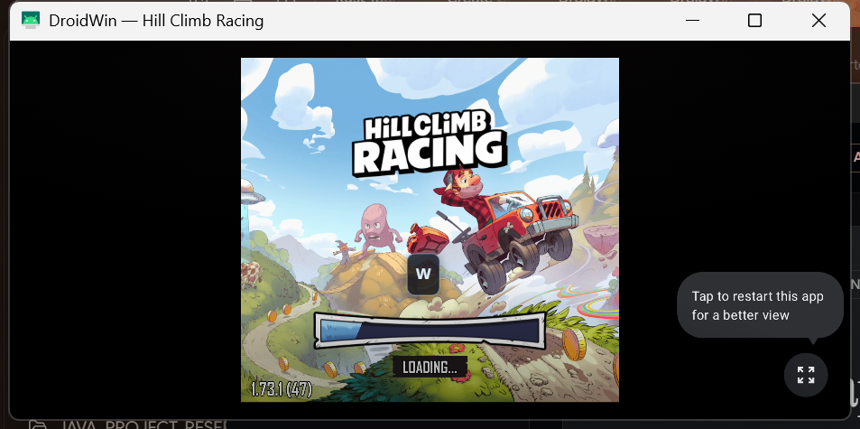
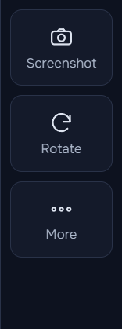

<div align="center">



# WINAPK

**Run Android apps and games in their own real Windows windows.**

Not a phone-shaped rectangle inside an emulator. One window per app, on its own Android display —
with the controls anchored to the window they belong to, and keyboard mapping that starts from the
real control you click.

<br />

[](release/WINAPK/Setup.exe)
[](release/WINAPK/BUILD_REPORT.txt)

<br />


<sub><b>One shared Android runtime · one virtual display per app · one window per app</b></sub>

</div>

---

## Why it exists

Running an Android game inside a phone emulator gives you a phone-shaped rectangle and a mouse that
pretends to be a finger. WINAPK treats **the window itself** as the product:

<table>
<tr>
<td width="33%" valign="top">

### 🪟 One window per app
Each app runs on its own virtual display, so four apps can be open at once without sharing a screen.
Move, resize or rotate any of them independently.

</td>
<td width="33%" valign="top">

### 🎯 Controls where the app is
The rail and the navigation bar are anchored to the window they belong to, and follow it when it
moves, resizes or rotates.

</td>
<td width="33%" valign="top">

### ⌨️ Mapping from the app itself
Click the real control on the real screen, press a key. The point is stored as a percentage of the
Android display, so it survives resize and rotation.

</td>
</tr>
</table>

---

## Screenshots

<div align="center">

| Click-to-place key mapping | Universal shortcuts |
| :---: | :---: |
|  |  |
| Click a control on the game, press a key — the point, the key and the profile are saved per Android package. | `Shift+A/H/R/M/P/O` work in every Android app, before any game profile. |

| Control rail |
| :---: |
|  |

</div>

---

## Features

| | Area | What you get |
| :---: | :--- | :--- |
| 📦 | **Library** | Install APKs from the UI, see what is installed, open or stop an app |
| 🪟 | **App windows** | Per-app virtual display, own title, free resize, portrait & landscape |
| 🎛️ | **Control rail** | Screenshot of that window's display, rotate, More → key mapping |
| ◀ | **Navigation** | Back · Home · Recent Apps, always at the bottom of the window |
| ⌨️ | **Universal keys** | `Shift+A/H/R/M` nav, `Shift+P` screenshot, `Shift+O` rotate — all rebindable |
| 🎮 | **Key mapping** | Click the real control → press a key → saved per package and reloaded |
| 👁️ | **Overlay** | Labels on the game; `Ctrl+Shift+R` hides everything without losing the profile |
| ⚡ | **Performance** | vCPU / RAM / GPU plan with requested-vs-applied reporting and restart notice |
| 🤖 | **Agent control** | MCP endpoint (JSON-RPC over loopback) and a `WINAPK` CLI over the same runtime |
| 🏷️ | **Your name** | Rename the app in Settings; the title bar, header and app windows follow |
| 📐 | **Compact** | 900×560 minimum; below 1040 px the sidebar becomes an icon rail |
| 🧹 | **Cleanup** | Closing WINAPK releases held keys, closes its windows and stops the emulator it started |

---

## Quick start

### Install

```powershell
.\release\WINAPK\Setup.exe
```

First launch sets up its own Android runtime (SDK, system image, AVD) from Google's distribution, then
reuses it. Nothing else has to be installed beforehand.

### Run the portable build

```powershell
.\release\WINAPK\WINAPK.exe
```

### Build from source

```powershell
pnpm install
pnpm dev            # frontend only
pnpm tauri dev      # full app
pnpm tauri build    # release EXE + NSIS installer
```

**Requirements** — Node 20+, pnpm, Rust (MSVC toolchain), WebView2, and a Windows machine with
virtualisation enabled for the emulator.

---

## Keyboard

**Universal — the same in every Android app** (editable in *Key mapping*):

| Action | Default | Action | Default |
| :--- | :---: | :--- | :---: |
| Back | `Shift+A` | Menu | `Shift+M` |
| Home | `Shift+H` | Screenshot | `Shift+P` |
| Recent Apps | `Shift+R` | Rotate | `Shift+O` |
| Show / hide mapping | `Ctrl+Shift+R` | | |

Universal chords are decided **before** any per-app profile, so a game cannot swallow Android's own
navigation. A chord needs a modifier, so plain typing is never captured, and a chord already used by
another action or app mapping is refused with a reason instead of being silently shadowed.

**Per-app mapping** — *More → Key mapping → Place on the game*, click the control, press the key,
**Add**. The point is stored as a percentage of the Android display, so resizing, moving or rotating
the window keeps it on the same control.

---

## 🤖 Agent control (MCP + CLI)

WINAPK ships an MCP server bound to loopback with a per-session token — **34 tools**, from runtime
status and package management to screenshots, taps and workflows. The `WINAPK` CLI is a client of
the same endpoint, so it never starts a second emulator.

```powershell
WINAPK status
WINAPK apps list
WINAPK apps open com.fingersoft.hillclimb
WINAPK mapping save com.fingersoft.hillclimb --key W --tap 49,61
WINAPK capture screenshot
WINAPK tools              # 27 commands, 4 KB — far smaller than tools/list
```

Point an MCP client at the stdio bridge:

```json
{
  "mcpServers": {
    "winapk": {
      "command": "C:\\path\\to\\WINAPK.exe",
      "args": ["--mcp-stdio"]
    }
  }
}
```

<sub>Transport, tool schemas, examples and troubleshooting: [docs/MCP_AGENT.md](docs/MCP_AGENT.md) · CLI: [docs/CLI.md](docs/CLI.md)</sub>

---

## 🏷️ Make it yours

*Settings → Application name* renames the title bar, the top bar, the About panel and every app
window opened afterwards. The value is trimmed, limited to 40 characters, refused when empty or
multi-line, saved locally, and read back at startup — so the name is already in effect next launch.

This is **display branding only**. The executable, the installer's product name and the bundle
identifier are build-time values and are left alone, which is what keeps shortcuts and updates
working.

---

## Architecture

```text
┌──────────────── Desktop (Tauri) ────────────────┐
│  main window      library, installer, settings   │
│  overlay-labels   transparent label layer        │
│  overlay-nav      Back · Home · Recents          │
│  overlay-rail     Screenshot · Rotate · More     │
│  overlay-mapper   key-mapping panel              │
└───────────────┬─────────────────────────────────┘
                │ one runtime, one adb server
┌───────────────▼─────────────────────────────────┐
│ Rust core                                        │
│  runtime     emulator + adb + scrcpy lifecycle   │
│  input       keyboard hook, profiles, dispatch   │
│  overlay     anchoring, visibility, placement    │
│  capture     screenshots, recordings             │
│  agent       MCP server, CLI client, control API │
└───────────────┬─────────────────────────────────┘
                │ adb shell input on one display id
┌───────────────▼─────────────────────────────────┐
│ Android Emulator  ·  one virtual display per app │
└──────────────────────────────────────────────────┘
```

One owner per concern: the runtime owns processes, `InputController` owns profiles and key decisions,
`Overlay` owns window geometry and visibility, and the React layer renders whatever the backend
pushes — it never mirrors state.

---

## Testing

```powershell
pnpm test                                              # 122 frontend tests
cargo test --manifest-path src-tauri/Cargo.toml --lib  # 271 Rust tests
```

| Check | Result |
| :--- | :--- |
| `tsc --noEmit` | clean |
| `pnpm test` | **122 passed** |
| `cargo test --lib` | **271 passed, 0 failed** |
| `cargo fmt --check` | clean |
| `pnpm tauri build` | EXE + NSIS installer |

Live behaviour was verified against the packaged executable: rename, persistence across a restart,
reset, window-title updates, clean shutdown with no emulator or scrcpy left behind, and the compact
layout at 900×560. Details, hashes and the checks that were **not** run:
[release/WINAPK/BUILD_REPORT.txt](release/WINAPK/BUILD_REPORT.txt).

---

## Compatibility & known limits

- **Windows 11 x64** (Windows on ARM is not supported: the system image is x86_64). Hardware
  virtualisation is required for a usable emulator; without it WINAPK still runs, and the Runtime
  screen says acceleration is unavailable rather than pretending otherwise.
- ARM-only packages cannot run on this image, and apps that insist on Google Play services usually
  fail. WINAPK reports what Android reports rather than predicting compatibility.
- Recording an app's own virtual display is not supported by `screenrecord`; the button is therefore
  not offered.
- Rotating reopens the window on the other orientation surface; scrcpy ignores a requested window
  size for a new display, so the frame can keep the old shape.
- `Ctrl+Shift+R` cannot be rebound yet; the other six can.
- No control detection: mapping a game is place → key, never a guessed profile.
- The AVD WINAPK creates is still named `DroidWin_API36` on disk. That identifier is kept on purpose:
  renaming it would orphan the system image and settings of anyone upgrading from an earlier build.

---

## Security

The agent endpoint binds to **loopback only** and requires a per-session token, with Host and Origin
checks. The guest-to-host boundary is documented and tested separately — see
[docs/HOST_ISOLATION.md](docs/HOST_ISOLATION.md) for what is contained, what is not, and why running
untrusted APKs still deserves a dedicated Windows account.

---

## Repository layout

```text
src/                 React + TypeScript UI (main window, overlays, screens)
src-tauri/src/       Rust backend: runtime, input, overlay, capture, agent, cli
src-tauri/tests/     live harnesses (mapping, capture, isolation, phones)
release/WINAPK/      shipped EXE, installer, README and build report
docs/                runtime setup, host isolation, MCP, CLI, decisions, images
```

---

<div align="center">
<sub>MIT licensed · scrcpy is bundled under Apache-2.0 · the Android SDK and emulator are provided by you and are not redistributed</sub>
</div>
