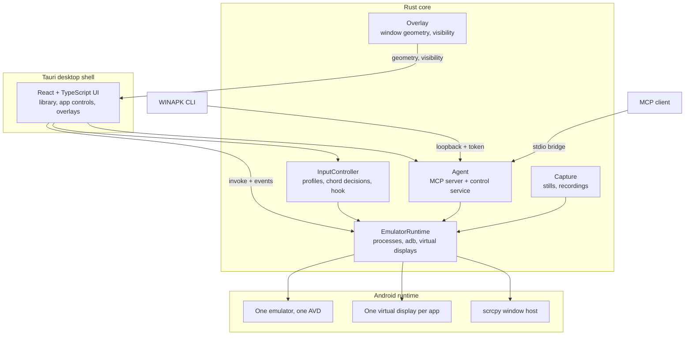
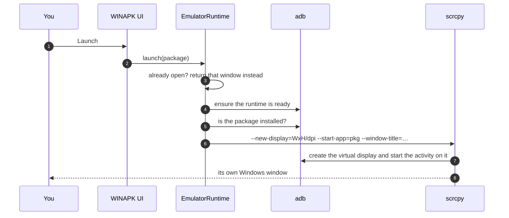
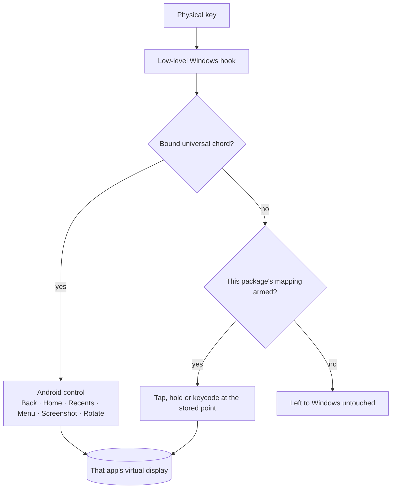

<div align="center">


# WINAPK

<h3>Android. Unboxed.</h3>

<p><strong>Your apps. Your windows. Your control.</strong></p>

A Windows-native Android workspace: every app runs in its own real Windows window, on its own
Android display, with the controls anchored to that window and keyboard mapping that starts from the
control you click.

<br />

[](release/WINAPK/Setup.exe)
[](release/WINAPK/BUILD_REPORT.txt)

<br />


[](LICENSE)

<sub><b>One shared Android runtime · one virtual display per app · one window per app</b></sub>

<sub><a href="#why-it-exists">Why it exists</a> · <a href="#see-it-working">Screenshots</a> · <a href="#features">Features</a> · <a href="#keyboard">Keyboard</a> · <a href="#install">Install</a> · <a href="#architecture">Architecture</a> · <a href="#agent-control-mcp--cli">CLI &amp; MCP</a> · <a href="#testing">Testing</a> · <a href="#roadmap">Roadmap</a></sub>

</div>

---

## Why it exists

Running an Android game inside a phone emulator gives you a phone-shaped rectangle and a mouse that
pretends to be a finger. WINAPK treats **the window itself** as the product:

<table>
<tr>
<td width="33%" valign="top">

### 🪟 One window per app
Each app runs on its own virtual display, so four apps can be open at once without sharing a screen.
Move, resize or rotate any of them independently.

</td>
<td width="33%" valign="top">

### 🎯 Controls where the app is
The rail and the navigation bar are anchored to the window they belong to, and follow it when it
moves, resizes or rotates.

</td>
<td width="33%" valign="top">

### ⌨️ Mapping from the app itself
Click the real control on the real screen, press a key. The point is stored as a percentage of the
Android display, so it survives resize and rotation.

</td>
</tr>
</table>

| | Traditional emulator workflow | **WINAPK** |
| :--- | :--- | :--- |
| **Where apps run** | One emulator window, shared by everything | Each app on its own virtual display, in its own Windows window |
| **Controls** | Configured against a phone screen, inside emulator chrome | Anchored to the app window; mapped by clicking the real control |
| **Navigation** | Emulator-level | Back · Home · Recents at the bottom of *that* window |
| **Automation** | Not part of the app | MCP tools and a CLI over one local, token-protected endpoint |

<sub>This describes WINAPK's intended experience — not an audit of every other emulator.</sub>

---

## See it working

Real captures from a running session, not mockups.

<div align="center">

| Click-to-place key mapping | Universal shortcuts |
| :---: | :---: |
|  |  |
| Click a control on the game, press a key — the point, the key and the profile are saved per Android package. | `Shift+A/H/R/M/P/O` work in every Android app, before any game profile. |

| Control rail |
| :---: |
|  |

</div>

---

## Features

<table>
<tr>
<td width="50%" valign="top">

#### 🪟 Desktop experience

- **One window per app** — each app on its own virtual display, so four can be open at once
- **Free resize** — portrait and landscape, independently per window
- **Anchored controls** — the rail and navigation bar follow the window they belong to
- **Compact by default** — 900×560 minimum; below 1040 px the sidebar becomes an icon rail

</td>
<td width="50%" valign="top">

#### 🎮 Input experience

- **Click-to-place mapping** — click the real control, press the key; stored as a percentage of the Android display
- **Universal chords** — `Shift+A/H/R/M/P/O` decided before any game profile, so a game cannot swallow navigation
- **Overlay labels** — `Ctrl+Shift+R` hides them without losing the profile
- **Per-package profiles** — saved with that Android package, reloaded with the app

</td>
</tr>
<tr>
<td valign="top">

#### ⚡ Runtime and performance

- **Own Android runtime** — installed on first run from Google's distribution, then reused
- **Honest resource reporting** — the plan you requested is shown apart from what Android reports
- **Phone display control** — size and density through `wm`, without restarting the emulator
- **Real cleanup** — closing WINAPK stops the emulator it started and leaves yours alone

</td>
<td valign="top">

#### 🤖 Developer and agent

- **34 MCP tools** — runtime state, packages, taps, screenshots, workflows and triggers
- **CLI on the same runtime** — 27 commands; it never starts a second emulator
- **Loopback + token** — per-session token, with Host and Origin checks
- **Your name** — rename the app; the title bar, header and app windows follow

</td>
</tr>
</table>

---

## Keyboard

### Universal — the same in every Android app

| Action | Default | Action | Default |
| :--- | :---: | :--- | :---: |
| Back | `Shift+A` | Menu | `Shift+M` |
| Home | `Shift+H` | Screenshot | `Shift+P` |
| Recent Apps | `Shift+R` | Rotate | `Shift+O` |
| Show / hide mapping | `Ctrl+Shift+R` | | |

Universal chords are decided **before** any per-app profile, so a game cannot swallow Android's own
navigation. A chord needs a modifier, so plain typing is never captured, and a chord already used by
another action or app mapping is refused with a reason instead of being silently shadowed.

### Per-app mapping

Mapping belongs to one Android package, and it is **off** until you switch it on for that package.
Nothing is intercepted until then.

| | Step | What happens |
| :---: | :--- | :--- |
| **1** | Open the app, then **More → Key mapping** | The mapping panel opens over that window, with the key list and the display geometry |
| **2** | **Place on the game** | The overlay waits for your next click and the panel steps out of the way |
| **3** | Click the control you want to reach | The click lands on the app, so the real button is under the point — not a guessed coordinate |
| **4** | Press the key you want | Modifiers are accepted, and `Escape` is captured as a mapping instead of closing the panel |
| **5** | Choose the action | **Tap**, **Hold**, or an Android keycode — shown as `Tap 24% / 36%` or `Android SPACE` in the list |
| **6** | **Add mapping** | The point is stored as a percentage of the Android display, so resize and rotation keep it on the same control |
| **7** | **Mappings armed** | Mapping is saved for that package and reloaded next time you open it; **Reset mappings** clears them all |

The panel also lists every mapping with its own on/off switch and a per-key remove button, so a
profile can be trimmed without being rebuilt.

---

## Install

### 1 · Download

| File | What it is |
| :--- | :--- |
| [Setup.exe](release/WINAPK/Setup.exe) | NSIS installer, per-user (no admin prompt): Start Menu shortcut, uninstaller, `.apk` association |
| [WINAPK-portable.zip](release/WINAPK/WINAPK-portable.zip) | Unzip anywhere and run: the app **and** its bundled window host |
| [WINAPK.exe](release/WINAPK/WINAPK.exe) | The application binary inside that zip. On its own it has no window host, so it cannot open app windows |
| [BUILD_REPORT.txt](release/WINAPK/BUILD_REPORT.txt) | The checks that produced these binaries, and their SHA-256 |

The download button at the top points at the exact installer whose hash is in the build report.
Tagged releases publish the same artifact under **Releases**.

> **Neither binary is code-signed yet.** A freshly downloaded copy therefore gets a SmartScreen
> *"Windows protected your PC"* prompt on first run. See [Troubleshooting](#troubleshooting) for what
> that means and how to check what you are running.

### 2 · Run the installer

```powershell
.\release\WINAPK\Setup.exe
```

### 3 · First launch

WINAPK has no bundled runtime. First launch offers **Install Android runtime**: it downloads the SDK,
system image and an AVD from Google's distribution, then reuses them. Accept Google's licence terms
and wait for *"Android runtime is installed"*.

Already have an SDK? *Settings → Android runtime → Choose SDK folder* skips the download entirely.

### 4 · Portable build

```powershell
Expand-Archive .\WINAPK-portable.zip -DestinationPath .\WINAPK-portable
.\WINAPK-portable\WINAPK.exe
```

Keep `resources\` beside `WINAPK.exe`. That folder holds the window host — scrcpy, adb and SDL, about
26 MB — and it is what draws each app's window. A bare `WINAPK.exe` copied somewhere on its own will
start, but an app window cannot open.

### 5 · From source

```powershell
pnpm install
pnpm dev            # frontend only
pnpm tauri dev      # full app
pnpm tauri build    # release EXE + NSIS installer
```

### Requirements

| | |
| :--- | :--- |
| **OS** | Windows x64. Built and run on this machine's Windows; a clean-VM install has not been tested, and Windows on ARM is not supported (the system image is x86_64). |
| **Virtualisation** | Required for a usable emulator. Without it WINAPK still runs and says acceleration is unavailable. |
| **Disk** | ~6 GB free for the one-time Android runtime download. |
| **Memory** | The emulator uses 2–8 GB depending on the plan you choose (2 GB is the floor). |
| **WebView2** | Required; present on Windows 11. |
| **From source** | Node 20+, pnpm, and Rust with the MSVC toolchain. |

---

## Architecture

Three layers, and exactly one owner per concern:



The runtime owns processes, `InputController` owns profiles and key decisions, `Overlay` owns window
geometry and visibility, and the React layer renders whatever the backend pushes — it never mirrors
state.

### How an app gets its window

WINAPK does not open a display and then tell Android to start an activity in it. It asks **scrcpy**
for a new virtual display and hands it the package to start, which is why the window, its surface and
its keyboard backend are decided in one step:



The title carries the app's own name, so a rename is never half-applied, and a landscape-locked game
gets a landscape surface from its own manifest rather than being rotated and clipped.

### How a key reaches Android



Mapping is per Android package and off by default, so a key is only intercepted while a profile you
armed is in front.

### A note on the name

The product is **WINAPK**; a few internal identifiers still read `droidwin`, and that is deliberate:

| Where | Value | Why it stays |
| :--- | :--- | :--- |
| Cargo package and binary target | `droidwin` | Renaming the crate and its `droidwin_lib` target is a build-wide change with no user-visible benefit |
| Bundle identifier | `app.droidwin.desktop` | It is the on-disk data directory (settings, mappings, database); changing it would orphan every existing install |
| AVD on disk | `DroidWin_API36` | Renaming it would orphan the system image and settings of anyone upgrading |
| Shipped executable | `WINAPK.exe` | `mainBinaryName` in `tauri.conf.json`, so the shortcut, installer and title bar all read WINAPK |

---

## Agent control (MCP + CLI)

WINAPK ships an MCP server bound to loopback with a per-session token — **34 tools**, from runtime
status and package management to screenshots, taps, workflows and triggers. The `WINAPK` CLI is a
client of the same endpoint, so it never starts a second emulator.

```powershell
WINAPK status
WINAPK apps list
WINAPK apps open com.fingersoft.hillclimb
WINAPK mapping save com.fingersoft.hillclimb --key W --tap 49,61
WINAPK capture screenshot
WINAPK tools              # every command name and usage, no schema payload
```

Point an MCP client at the stdio bridge:

```json
{
  "mcpServers": {
    "winapk": {
      "command": "C:\\path\\to\\WINAPK.exe",
      "args": ["--mcp-stdio"]
    }
  }
}
```

**Boundaries.** The server listens on `127.0.0.1` only, on a port picked per session, and requires
`Authorization: Bearer <token>` (or an `x-droidwin-token` header) on every request, with Host and
Origin checks. The token is regenerated each session and written to the endpoint file in the app data
directory — the file exists only while the agent endpoint is enabled. Exit codes are `0` success,
`1` refused, `2` endpoint unreachable, `64` usage.

<sub>Transport, tool schemas, examples and troubleshooting: [docs/MCP_AGENT.md](docs/MCP_AGENT.md) · CLI: [docs/CLI.md](docs/CLI.md)</sub>

---

## 🏷️ Make it yours

*Settings → Application name* renames the title bar, the top bar, the About panel and every app
window opened afterwards. The value is trimmed, limited to 40 characters, refused when empty or
multi-line, saved locally, and read back at startup — so the name is already in effect next launch.

This is **display branding only**. The executable, the installer's product name and the bundle
identifier are build-time values and are left alone, which is what keeps shortcuts and updates
working.

---

## Testing

```powershell
pnpm test                                              # 122 frontend tests
cargo test --manifest-path src-tauri/Cargo.toml --lib  # 271 Rust tests
```

| Check | Result |
| :--- | :--- |
| `tsc --noEmit` | clean |
| `pnpm test` | **122 passed** |
| `cargo test --lib` | **271 passed, 0 failed** |
| `cargo fmt --check` | clean |
| `pnpm tauri build` | EXE + NSIS installer |
| Installer round trip | Silent install into a temp directory, then uninstall: `WINAPK.exe`, `resources\scrcpy`, the Start Menu shortcut and the HKCU uninstall entry all appeared and were all removed. The installer runs `asInvoker` — per-user, no admin prompt. |
| Signing | **Not signed.** `Get-AuthenticodeSignature` reports `NotSigned` for both `Setup.exe` and `WINAPK.exe`. |

**What this build verified** against the packaged executable: rename, persistence across a restart,
reset, window-title updates, clean shutdown with no emulator or scrcpy left behind, and the compact
layout at 900×560.

The installer round trip above was run on this machine, which already has WebView2 and the Android
tools — it shows the payload is complete and removal is clean, not that a bare Windows install works.
The `.apk` association is the one thing the uninstaller leaves in the registry.

**What was verified in earlier passes and is unchanged here**: APK install and launch, one window per
app, universal `Shift+A/H/R/M/P/O` chords, click-to-place mapping saved and delivered, screenshots and
rotation. The two lists are kept apart on purpose — see
[release/WINAPK/BUILD_REPORT.txt](release/WINAPK/BUILD_REPORT.txt), which also names every check that
was **not** run (installer install/uninstall on a clean machine, signing, MCP `tools/list` size,
performance numbers).

---

## Compatibility & known limits

- **Windows 11 x64** (Windows on ARM is not supported: the system image is x86_64). Hardware
  virtualisation is required for a usable emulator; without it WINAPK still runs, and the Runtime
  screen says acceleration is unavailable rather than pretending otherwise.
- ARM-only packages cannot run on this image, and apps that insist on Google Play services usually
  fail. WINAPK reports what Android reports rather than predicting compatibility.
- Recording an app's own virtual display is not supported by `screenrecord`; the button is therefore
  not offered for an app window. Recording the phone's display works.
- Rotating reopens the window on the other orientation surface; scrcpy ignores a requested window
  size for a new display, so the frame can keep the old shape.
- `Ctrl+Shift+R` cannot be rebound yet; the other six can.
- No control detection: mapping a game is place → key, never a guessed profile.

---

## Troubleshooting

| Symptom | What to do |
| :--- | :--- |
| *Windows protected your PC* when you run the installer | Expected on any copy downloaded from the internet: the build is not code-signed, so SmartScreen has no publisher to show. **More info → Run anyway**, or build from source if you would rather not trust an unsigned binary. |
| An app window never opens from the portable build | `resources\` was left behind. Extract the whole zip and run `WINAPK.exe` from inside it, not a copy of just the exe. |
| The setup screen appears on first launch | Expected on a PC with no Android SDK. Press **Install Android runtime** and accept Google's licence terms — or point WINAPK at an SDK you already have: *Settings → Android runtime → Choose SDK folder*. |
| The Runtime screen says acceleration is unavailable | Virtualisation is off in firmware or Hyper-V is not enabled. WINAPK still runs, but the emulator will be slow; the screen reports what the emulator itself answered rather than guessing. |
| A window opens black or empty | Some apps refuse a secondary display or draw only on display 0. Open the **Attention** panel: it names the app, shows the evidence it collected, and offers *Retry launch* or *Reopen window*. |
| A mapped key does nothing | Mapping is per Android package and is **off** until you enable it: *Applications → Controls* on that app's row, or **Mappings armed** in the mapping panel. |
| A shortcut chord is refused | A chord needs a modifier, and one already used by another action or app mapping is refused with a reason instead of being silently shadowed. Pick another chord. |
| `WINAPK status` reports an unreachable endpoint | The agent endpoint exists only while WINAPK runs with it enabled (*Agent* screen). The endpoint file is rewritten per session, so a stale one is reported as unreachable rather than retried forever. |
| An emulator outlives the app | *Settings → Keep the emulator running after WINAPK closes* is on. Turn it off to stop the emulator WINAPK started. An emulator you started yourself is never touched. |

---

## Security

The agent endpoint binds to **loopback only** and requires a per-session token, with Host and Origin
checks. The guest-to-host boundary is documented and tested separately — see
[docs/HOST_ISOLATION.md](docs/HOST_ISOLATION.md) for what is contained, what is not, and why running
untrusted APKs still deserves a dedicated Windows account.

---

## Roadmap

### Shipped and verified

- [x] One window per app, on its own virtual display
- [x] Click-to-place key mapping, saved per Android package
- [x] Universal `Shift+A/H/R/M/P/O` chords, rebindable
- [x] MCP server + CLI over one runtime, loopback-only with a token
- [x] Customisable application name
- [x] Compact layout down to 900×560

### Shipped, with the limit documented

- [ ] **Rotation** — the window reopens on the other surface, but the frame keeps its old shape
  because scrcpy ignores a requested size for a new display
- [ ] **Recording an app window** — the phone's display records; a virtual display cannot, so the
  button is not offered for an app rather than pretending
- [ ] **Installer verification** — the installer is built and its hash is recorded, but it has not
  been installed and uninstalled on a clean machine

### Planned

- [ ] Rebinding `Ctrl+Shift+R` — the other six universal chords can be changed today
- [ ] Control detection — mapping a game is click → key; WINAPK does not guess a profile from a
  screenshot
- [ ] A clean-machine verification pass, including Windows 10

---

## Repository layout

```text
src/                 React + TypeScript UI (main window, overlays, screens)
src-tauri/src/       Rust backend: runtime, input, overlay, capture, agent, cli
src-tauri/tests/     live harnesses (mapping, capture, isolation, phones)
release/WINAPK/      shipped EXE, installer, README and build report
docs/                runtime setup, host isolation, MCP, CLI, decisions, images
```

---

## Contributing

Issues and pull requests are welcome. A useful change comes with the check that covers it:

```powershell
pnpm install
pnpm test
cargo test --manifest-path src-tauri/Cargo.toml --lib
cargo fmt --check
```

Both test suites must stay green, and behaviour that only shows up on Windows should say which build
it was seen on. If a limitation above changes, update it in the same pull request.

---

## License

[MIT](LICENSE). scrcpy is bundled under Apache-2.0. The Android SDK and emulator are provided by you
and are not redistributed with WINAPK.

<div align="center">
<br />
<sub>Built with Tauri 2 · Rust · React 19 — and scrcpy, which does the hard part</sub>
</div>
